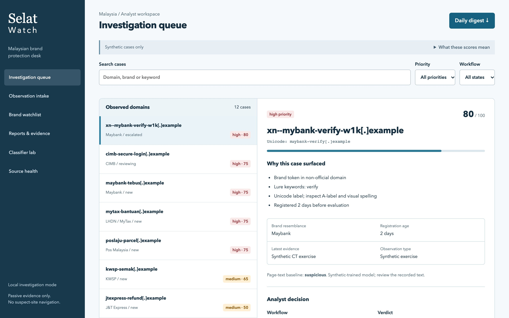
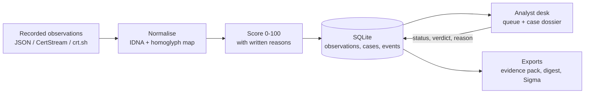
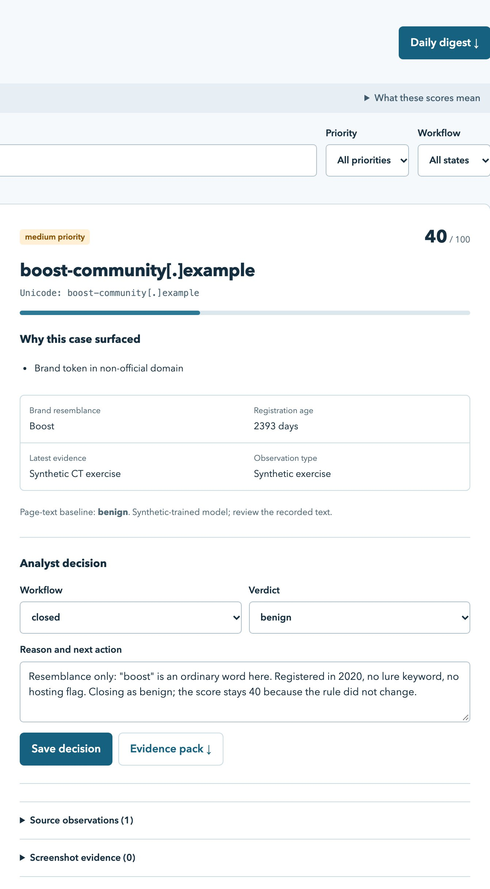
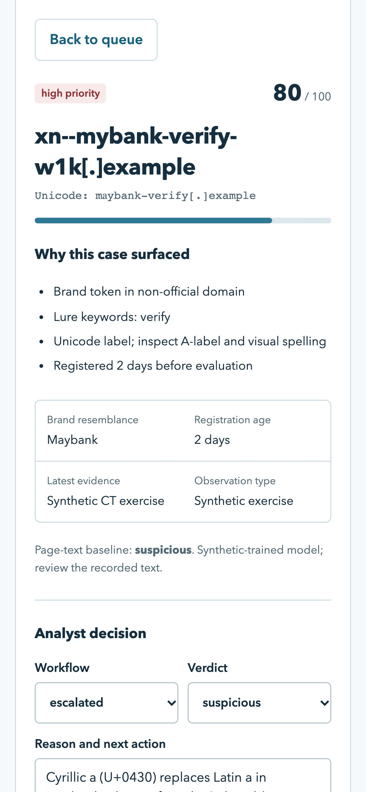
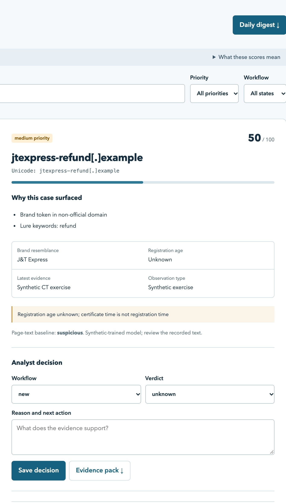

# Selat Watch

A local investigation desk for domains that impersonate Malaysian banks, wallets, couriers and government services. It helps an analyst decide which lookalike to look at first, and keeps a record of why.



The idea in one line: **a high score means "look at this first", not "this is phishing".** The score ranks the queue. The verdict is a separate, human decision with a written reason.

## The attack

Brand impersonation starts with a domain that looks right at a glance. Attackers swap a Latin letter for a look-alike from another alphabet (a Cyrillic `а` for `a`, stored as punycode beginning `xn--`), hang a lure word such as `verify` or `tebus` off the brand name, hide the brand inside a longer host such as `maybank.com.my.attacker.example`, and register it days before the campaign. Selat Watch takes each of those tricks apart and shows which ones a domain uses.

## What it does

- Takes recorded domain observations (JSON, CertStream or crt.sh exports) and normalises each domain, including Unicode lookalikes. A *homoglyph* is a character from another alphabet that looks like a Latin one, such as Cyrillic `а` in place of `a`.
- Compares each domain against 20 editable brand profiles and gives a 0–100 priority score with the reasons written out.
- Keeps unknown facts unknown. A missing registration date stays "Unknown"; a certificate date is never treated as the domain's age.
- Records the analyst's workflow state, verdict and reason as an audit trail, separate from the score.
- Exports a ZIP evidence pack with a SHA-256 hash for every file, plus a daily digest and an experimental Sigma rule (a vendor-neutral detection-rule format) for reviewed domains.

It never opens, resolves or screenshots a suspect site. Nothing is sent anywhere.

## How it works



Each domain is converted to its ASCII form (IDNA/UTS #46), decoded back to Unicode for display, and mapped through a small confusable-character table before brand matching. Official domains are exempted by suffix boundary, so `maybank.com.my.attacker.example` still scores. The score adds brand resemblance (40, or 32 for a one-edit lookalike), lure keywords such as `tebus` or `verify` (up to 20), a Unicode label (15), registration under 30 days old (15) and a sourced hosting flag (10), capped at 100. Every observation is stored with its own hash; reviews and report records are appended as events, so the current state never overwrites the history.

## Design decisions

**The score is not the verdict.** Scores and verdicts live in different columns and change for different reasons. Rescoring never touches a verdict, and closing a case never edits its score. In the demo, `boost-community.example` scores 40 because "boost" matches a wallet brand, and the analyst closes it as benign with a reason. Both facts stay visible.

**Unknown stays unknown.** If an observation has no registration date, the age contributes zero points and the dossier says "Registration age unknown; certificate time is not registration time". It would be easy to borrow the certificate's `not_before` date, but a fresh certificate on an old domain is normal.

**Passive by design.** The tool works only on recorded evidence. Screenshots are imported with a capture time and provenance, never fetched. VirusTotal and URLhaus lookups run only from an explicit CLI command, read keys from the environment, and refuse synthetic records.

**Explainable over clever.** A short additive rule with written reasons is easy to argue with in a review meeting. The page-text classifier (a small naive Bayes baseline) is shown as a separate hint, labelled as trained on synthetic text.

**Local and loopback-only.** The server binds to `127.0.0.1`, checks the `Host` and `Origin` headers, requires JSON for writes and sends a strict Content-Security-Policy. It has no login, so it is not meant to be exposed on a network.

## Screenshots

<table>
  <tr>
    <td width="66%"></td>
    <td width="34%"></td>
  </tr>
  <tr>
    <td>A medium-score near-match closed as benign. The score stays 40; the decision trail shows what was decided, when and why.</td>
    <td>Phone layout: tapping a case scrolls to its dossier, with a way back to the queue.</td>
  </tr>
</table>



*A J&T Express lookalike with no registration date. The age shows as Unknown and adds no points. The raw observation and its SHA-256 identifier are underneath.*

A sample evidence pack from the demo is in [`docs/examples/`](docs/examples/), next to the saved evaluation results.

## Run it

Requires Python 3.11 or newer (tested with 3.14 on macOS).

```sh
git clone <this repo> selat-watch && cd selat-watch
python3 -m venv .venv
.venv/bin/python -m pip install -r requirements.txt
.venv/bin/python app.py --db work/demo.db serve --demo --port 8765
```

Open http://127.0.0.1:8765. `--demo` loads 12 synthetic observations into an empty database. Use `--port 0` to pick a free port.

Useful CLI commands:

```sh
.venv/bin/python app.py --db work/demo.db pack xn--mybank-verify-w1k.example work/case.zip
.venv/bin/python app.py --db work/demo.db digest
.venv/bin/python app.py permutations maybank      # candidate lookalikes under .example, never resolved
.venv/bin/python app.py evaluate-domains          # rule score vs. 12 authored labels
.venv/bin/python app.py evaluate                  # page-text baseline on 12 held-out examples
```

Provider and certificate-feed setup is in [`ops/OPERATIONS.md`](ops/OPERATIONS.md).

## Tests

```sh
.venv/bin/python -m unittest discover -s tests -v
```

Result on 20 October 2026 (Python 3.14.6, macOS): **16 tests, all passed.** They cover IDNA normalisation, official-domain boundaries, deduplication, date handling, allowlist and review persistence, evidence-pack hashes, provider adapters (mocked) and the HTTP origin checks.

`tests/browser/browser-check.cjs` is a Playwright walk-through of the main journey. It needs Playwright installed separately and a disposable database, since it adds test rows.

## Scope

- All observations, hosting signals, page text and labels are synthetic. Domains use the reserved `.example` suffix, apart from one official Maybank domain used to show the allowlist boundary.
- The CertStream, VirusTotal and URLhaus adapters are written and unit-tested with mocks, but have not been run against the live services.
- The evaluation numbers come from 12 authored cases each. They show the mechanics, not real-world accuracy. Both evaluations keep their false positive on purpose.
- The confusable map is narrow. It is not full Unicode spoof detection and not a public-suffix parser.
- Next: a fuller confusables table, an authenticated multi-user mode, and testing the adapters against real feeds with proper authorisation.

More detail, including bugs found during testing, is in the [case study](docs/CASE-STUDY.md).

## Project layout

```text
app.py                 CLI: serve, import, rescore, pack, digest, sigma, evaluate
watch/domain.py        normalisation, homoglyph map, brand matching, scoring rule
watch/store.py         SQLite store, audit events, evidence pack, digest, Sigma
watch/server.py        loopback HTTP API with host/origin checks and CSP
watch/adapters.py      CertStream/crt.sh parsing, VirusTotal and URLhaus lookups
watch/classifier.py    small naive Bayes page-text baseline and metrics
static/                analyst desk (HTML, CSS, vanilla JS)
fixtures/              brand profiles and synthetic observations
tests/                 unittest suite and a Playwright journey
ops/                   operations notes and systemd templates
docs/                  screenshots, case study, sample exports
```

---

Built by Selbinyyaz (Salli) Odekova · [Portfolio](https://selbinyyaz-odekova.web.app) · MIT License
